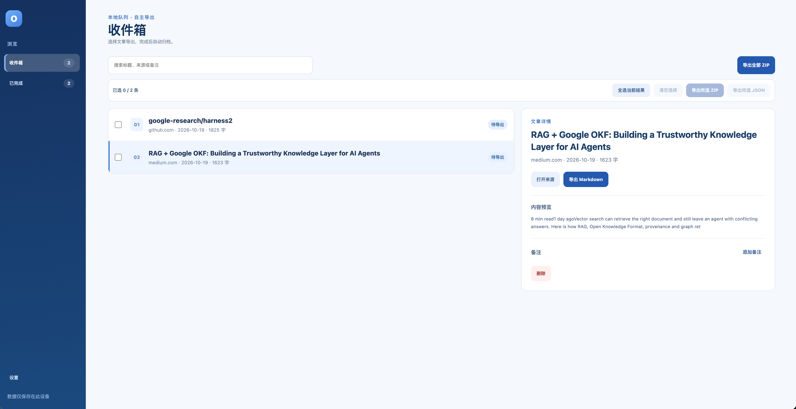
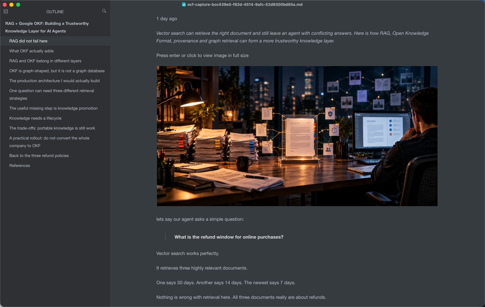

# Open Context Clipper

Language: **English** · [简体中文](README.zh-CN.md)

**Bring web articles into your own local knowledge base.**

Open Context Clipper is an open source Chrome extension for capturing the article you are reading. Preview the extracted text, decide whether to save it, then export clean Markdown for your notes, files, or other local knowledge tools. Extraction and queue storage happen on your device. No account or server is required.

## From the web to local Markdown

| 1. Capture deliberately | 2. Manage locally | 3. Export freely |
| --- | --- | --- |
| Preview the title, source, and extracted text. Nothing is saved until you confirm. | Search your local queue, inspect articles, add notes, and select multiple captures. | Download Markdown, bundle articles into a ZIP, or export selected records as JSON. |

### Preview before saving

Click the extension on an article page to inspect the extracted content and any warnings. Choose **Save to queue** only when the preview looks right. Closing the popup saves nothing.

<p align="center">
  
</p>

### Manage articles in a full browser tab

Choose **Open queue** to search your captures, inspect details, reopen a source, or export on demand. Articles waiting for export stay in **Inbox**. Once a download starts, they move to **Completed**, where you can find and export them again. Select several articles or export the current search results as a ZIP.



### Read and organize with your own tools

Exported Markdown includes the article title, source URL, capture time, author and note when present, and extracted body. Open it in Typora or another Markdown editor, or add it to your local knowledge base for further organization and backup.



## Install from source

You need desktop Google Chrome, Node.js, and npm. From the repository root:

```bash
npm ci
npm run build
```

Open `chrome://extensions`, turn on **Developer mode**, choose **Load unpacked**, and select the generated `dist/` directory. After a source update, rebuild and reload the extension on that page.

## Everyday workflow

1. Open a fully loaded article and click Open Context Clipper in the Chrome toolbar.
2. Check the title, source, author, publication date, text length, remote image count, and excerpt. Add an optional note.
3. Click **Save to queue**. If the same page and content were already captured, the extension tells you instead of silently creating another copy.
4. In **Inbox**, export one article as Markdown, selected articles as ZIP or JSON, or all current search results as ZIP.
5. A ZIP contains each article in `articles/` and the corresponding records in `captures.json`. Move the Markdown files into your own folders or knowledge base.

Chrome internal pages such as `chrome://` cannot be captured. The popup still lets you open the queue. On sign-in or paywalled pages, the extension works only with content already rendered in your current tab; review the preview before saving.

## Choose a language

The interface supports Simplified Chinese and English. It follows Chrome's interface language by default; other browser languages use English. Open **Queue → Settings → Language** to choose **Follow browser**, **简体中文**, or **English**. The queue updates immediately, and the popup uses the choice the next time it opens.

Fixed metadata labels in exported Markdown follow the interface language. Article titles, content, and your notes remain unchanged; JSON field names stay stable.

## Completed history

Completed captures are kept locally forever by default. In **Queue → Settings**, you can choose to keep them for 30 or 90 days. Cleanup runs only the next time you open the queue; Inbox captures are never automatically deleted. Re-exporting starts a new retention period from the latest export. Deleted captures cannot be restored in the extension, so check important downloads before enabling cleanup.

## Privacy and control

- The extension reads only the already rendered content of the current tab when you click it. It does not poll pages in the background or bypass sign-in and paywalls.
- Captures stay in the extension's local IndexedDB queue. They are not uploaded to Open Context Forge or a project server.
- Downloads start only when you choose an export. The extension cannot confirm that the file was ultimately saved, so check important exports before enabling automatic cleanup.
- It does not read or save cookies, credentials, or browsing history. Markdown keeps links to remote images instead of downloading the image files.

Local queue data belongs to the installed extension ID; uninstalling or loading from a different path may make older data unavailable. There is currently no JSON import. Export captures you want to keep before changing the installation.

## Current scope

The extension converts rendered article text from the current page into portable Markdown. Content that has not loaded, login prompts, and paywall previews can produce incomplete captures. It does not provide cloud sync, automatic scraping, AI organization, or automatic writes to another knowledge base.

## Development

```bash
npm test
npm run typecheck
npm run build
```

Automated tests cover extraction, queue behavior, and exports. Loading and interacting with the extension still require manual testing in Chrome.

Past verification notes are recorded in [verification history](docs/verification-history.md).

## License

This project is released under the [MIT License](LICENSE). Copyright © Shoukai Huang. Third-party dependencies retain their own licenses.
